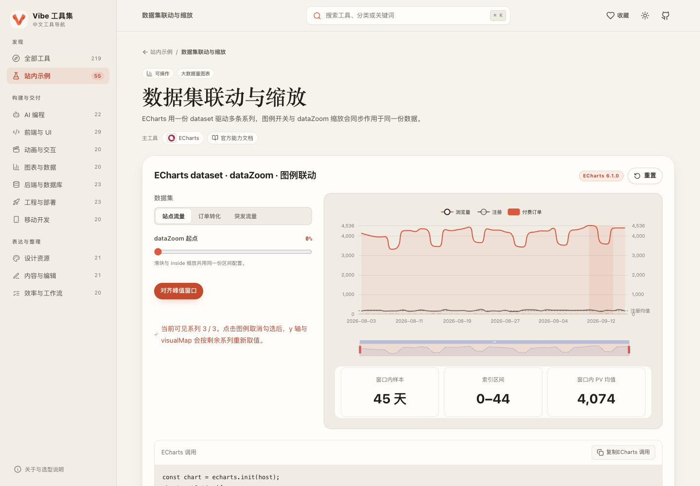

  
  <h1>Vibe 工具集</h1>
  
<strong>中文开发工具目录与交互示例</strong>

  
219 个工具 · 10 个分类 · 55 个技术栈示例

**[打开 Vibe](https://vibe.freakz2z.com) · [浏览示例](https://vibe.freakz2z.com/demos) · [反馈与建议](https://github.com/Freakz2z/Vibe/issues)**

## 这里有什么？

Vibe 是一个中文工具导航。你可以按用途找工具，查看简洁的介绍、使用场景与官方入口，也可以先在站内试试相关能力，再决定是否深入了解。

| 找什么 | 可以看到 |
| --- | --- |
| 编程与界面 | AI 编程、前端框架、UI 组件、状态管理 |
| 图形与数据 | 动画、3D、图表、流程图、地图 |
| 应用与工程 | 后端、数据库、测试、构建、移动开发 |
| 设计与内容 | 设计资源、图标、编辑器、Markdown、效率工具 |

## 看看界面

| 首页概览 | 暗色主题 |
| :---: | :---: |
|  |  |
| **示例目录** | **交互示例** |
|  |  |

## 怎么用？

首页提供收录数量、最新更新日期、分类统计、授权分布和平台统计；点击统计项即可进入对应列表。

1. **找工具**：选择分类，或搜索工具名称和关键词；用平台与费用筛选缩小范围。
2. **看详情**：查看用途、特点和相关工具，从详情页前往官网或源码。
3. **试示例**：带有示例的工具可以直接打开交互页面，调参数、改内容、看结果。
4. **加收藏**：点击工具旁的心形按钮，再从顶部的收藏入口集中查看。

在详情与目录之间往返时，筛选条件和浏览位置会保留。电脑和手机都能访问，主题可选择亮色、暗色或跟随系统。

## 示例可以做什么？

每个示例围绕一个技术栈的代表能力，直接运行对应的库或服务。

- 编排动画时间轴，调整弹簧，拖动和排列元素。
- 缩放图表、切换数据，观察图形与布局的变化。
- 编辑结构化内容，查看文档数据与处理结果。
- 体验数据缓存、字段校验、真实 SQL 查询和对象分段读取。

从工具详情进入它的专属示例，也可以在示例目录里按工具名称搜索。需要独立桌面环境或其他无法在本站运行的工具，保留资料和官方入口。

## 常见问题

**收藏会跨设备同步吗？**

收藏保存在当前浏览器，暂不支持跨设备同步；清理浏览器数据后也会清除收藏。

**工具都免费吗？**

不一定。目录可以按费用模式筛选，具体的免费额度、商业服务与许可证条件，请以工具官网为准。

**为什么部分工具没有 Logo？**

优先使用能够确认来源的官方 Logo；没有合适素材，或图片加载失败时，会显示文字标识。

**发现资料有误，或想推荐一个工具？**

欢迎在 [Issues](https://github.com/Freakz2z/Vibe/issues) 留下工具名称、官方链接和需要补充的内容。也欢迎提交示例和体验改进，见[贡献指南](CONTRIBUTING.md)。

## 开源与致谢

Vibe 的原创代码与文案采用 [MIT License](LICENSE)。第三方 Logo 和商标归各自权利人，见[第三方声明](THIRD_PARTY_NOTICES.md)。

分类浏览方式参考 [Vibe Code Tools](https://vibecodetools.dev/en)，README 的组织方式参考 [BiliBot](https://github.com/Freakz2z/BiliBot)。

需要运行或维护自己的版本，可查看[开发说明](docs/DEVELOPMENT.md)与[部署说明](docs/DEPLOYMENT.md)。
