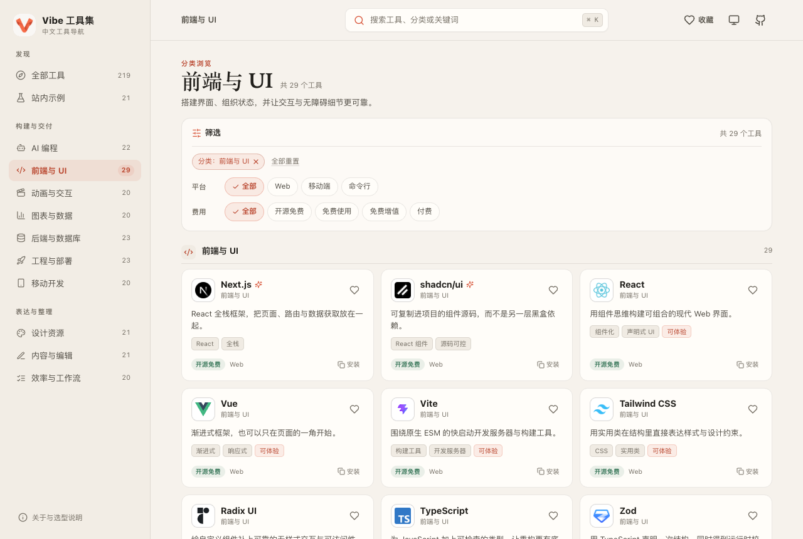
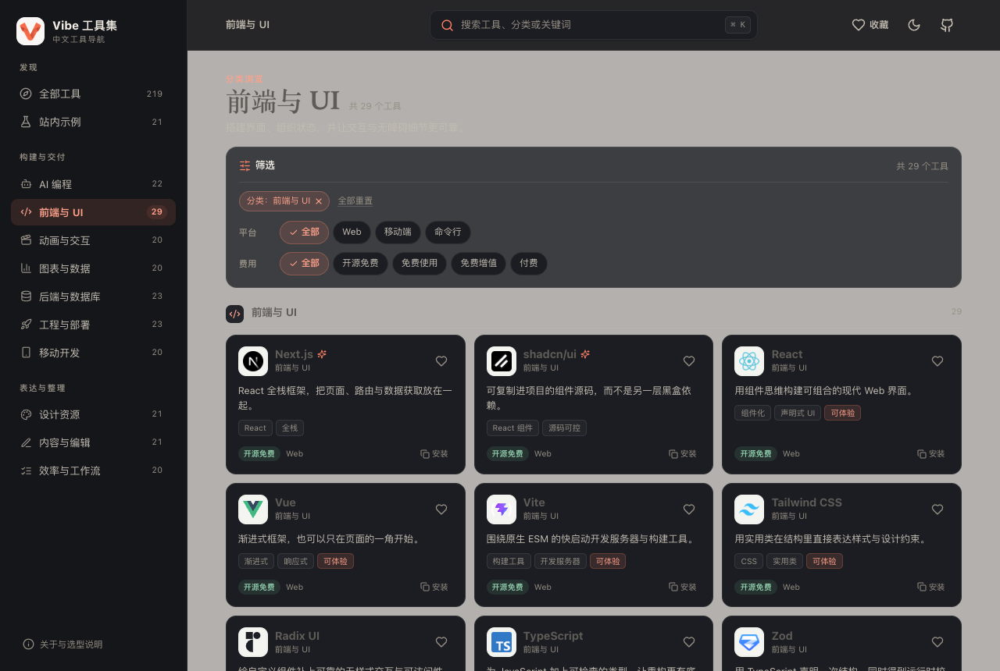
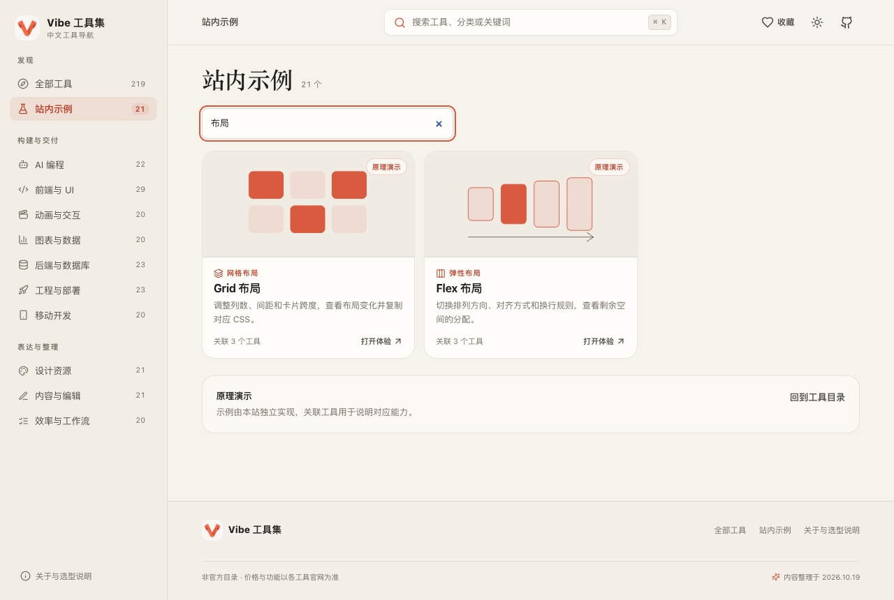
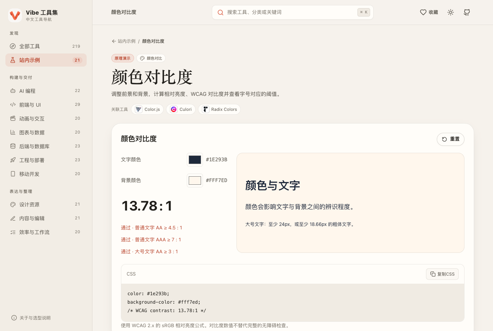

<div align="center">
  
  <h1>Vibe 工具集</h1>
  <p><strong>中文开发工具目录与可交互示例</strong></p>
  <p>219 个工具 · 21 个示例 &nbsp; / &nbsp; 桌面与手机 · 亮色与暗色</p>

[](https://github.com/Freakz2z/Vibe/actions/workflows/ci.yml)
[](LICENSE)

**[访问网站](https://vibe.freakz2z.com) · [站内示例](https://vibe.freakz2z.com/demos) · [快速开始](#快速开始) · [自行部署](#自行部署) · [参与贡献](CONTRIBUTING.md)**
</div>

## Vibe 能做什么？

Vibe 是一份可以自行维护和部署的中文工具目录。按分类浏览工具，通过搜索、平台和费用筛选缩小范围；进入详情查看用途、特点、官网与源码，并把需要的工具加入收藏。

- **219 个工具**：覆盖 AI 编程、前端、图形交互、图表、后端、工程、移动、设计、内容与效率。
- **21 个可交互示例**：调参数、看结果，包含布局、颜色、图形、文本与数据处理，以及排序、防抖、节流和缓存。
- **官方 Logo**：217 个图标来自官方来源并由本站 R2 提供；其余 2 个回退为文字，来源和校验和均可查阅。
- **连续的浏览路径**：筛选状态保存在 URL，进入详情和相关工具后返回，恢复原条件与滚动位置。
- **本地收藏与主题**：无需服务端账号，支持亮色、暗色和跟随系统。收藏不会自动跨设备同步。
- **Cloudflare 部署**：Workers 提供页面与只读 API，D1 保存工具资料，R2 存储品牌图片。

## 界面预览

| 工具目录 | 暗色主题 |
| :---: | :---: |
|  |  |
| **示例目录** | **交互示例** |
|  |  |

## 快速开始

需要 **Node.js 22.12+、npm**。本地开发使用模拟的 D1/R2，不需要 Cloudflare 账号。

```sh
git clone https://github.com/Freakz2z/Vibe.git
cd Vibe
npm ci
cp wrangler.example.jsonc wrangler.jsonc
npm run db:local
npm run assets:local
npm run build
npm run dev
```

打开 **http://localhost:8787**。页面、工具 API 和本地素材都由同一个 Worker 提供。退出时在运行终端按 `Ctrl+C`。

修改前端时，保持 Worker 运行，另开终端执行：

```sh
npm run dev:web
```

访问 **http://127.0.0.1:5173**，Vite 会把 `/api` 和 `/media` 请求转发到本地 Worker。

<details>
<summary>告诉 Agent 如何启动和验证 Vibe</summary>

将下面这段话复制给能联网、读文件和执行终端命令的 Agent：

```text
请帮我在本地运行 Vibe 工具集：
https://github.com/Freakz2z/Vibe

先读取 README 和 AGENTS.md，检查 Node.js 与 npm。
在独立目录克隆仓库，使用 wrangler.example.jsonc 创建本地配置。
初始化本地 D1 和 R2，构建并运行 Worker。
验证 /api/health、工具目录、21 个示例及一个实际交互，告诉我地址与退出方式。
本次只运行本地环境，不创建远程资源、不部署、不修改线上数据。
不要读取或输出我的 Cloudflare Token、Cookie 或其他密钥。
```

</details>

## 示例内容

| 方向 | 示例 |
| --- | --- |
| 布局与样式 | Grid、Flex、阴影、渐变、字体比例尺、颜色对比度 |
| 图形与运动 | 弹簧、贝塞尔缓动、SVG 路径、Canvas 粒子、值噪声 |
| 内容与文件 | Markdown、JSON、CSV、正则、本地图片尺寸与压缩 |
| 数据与交互 | 图表、看板、排序、防抖与节流、请求缓存 |

示例由本站独立实现，用来解释一类能力，**不会冒充关联工具的实际运行**。图片和文本处理在访客浏览器中完成；正则使用独立线程，复杂规则超时后终止。缓存示例使用本地定时器模拟网络请求。

## 自行部署

需要 Cloudflare 账号，并启用 Workers、D1 和 R2。使用自己的资源，不要沿用本仓库的生产账号配置。

```sh
cp wrangler.example.jsonc wrangler.jsonc
npx wrangler login
npx wrangler d1 create vibe-catalog
npx wrangler r2 bucket create vibe-assets
```

将 D1 创建结果中的 `database_id` 填进 `wrangler.jsonc`。如果修改数据库或存储桶名称，同步修改对应 binding 的资源名称和脚本参数。

部署时将 `vars.PUBLIC_ORIGIN` 设置为自己的 HTTPS 地址，并配置自定义域名：

```jsonc
"vars": { "PUBLIC_ORIGIN": "https://tools.example.com" },
"routes": [ { "pattern": "tools.example.com", "custom_domain": true } ]
```

域名需要在当前 Cloudflare 账号中管理。也可先使用 Workers 提供的 `workers.dev` 域名，并将 `PUBLIC_ORIGIN` 设置为该地址。

```sh
npm run db:remote
npm run assets:remote
npm run deploy
```

发布后检查 `/api/health`，应返回 `status: "ok"`、`database: "ready"` 与 `storage: "ready"`。API 与浏览器检查可切换到自己的地址：

```sh
node --import tsx scripts/verify-api.ts https://tools.example.com
node --import tsx scripts/verify-logos.ts https://tools.example.com
VIBE_TEST_BASE_URL=https://tools.example.com npm run test:e2e
```

Remote 命令会访问真实 Cloudflare 资源；本地测试不会自动执行部署。站点没有公开写入、文件上传、账号或管理接口。R2 存储桶不需要设为公开，通过 Worker 的 `/media/` 路由读取。

## 维护工具与示例

- [贡献指南](CONTRIBUTING.md)：内容字段、官方来源、Logo、示例实现和验证要求。
- [素材来源](docs/ASSETS.md) / [官方 Logo 清单](assets/icons/sources.json)：图像出处与 SHA-256。
- [收录核对](docs/CURATION.md)：来源、费用标签和已知访问限制。
- [第三方声明](THIRD_PARTY_NOTICES.md)：品牌、依赖和示例的许可边界。
- [验收记录](docs/VALIDATION.md)：实际检查与部署结果。

目录源为 `data/catalog.json`。更新数据后执行 `npm run seed:build -- --next` 创建新迁移，再应用到目标 D1。已发布迁移和稳定工具 ID 应保留。

<details>
<summary>目录结构与检查命令</summary>

```text
apps/web/       React 页面、主题与交互示例
src/            Workers 后端与媒体路由
shared/         API 数据契约
migrations/     D1 表结构与内容迁移
assets/icons/   官方工具图标与来源清单
scripts/        数据生成、素材同步与验收脚本
```

```sh
npm run seed:build
npm run typecheck
npm test
npm run build
npm run test:api
node --import tsx scripts/verify-logos.ts
npx playwright install chromium
npm run test:e2e
```

接口与浏览器测试需要本地 Worker 已启动。GitHub Actions 执行本地初始化和检查，不自动部署生产站点。

</details>

## 常见问题

**为什么有些工具没有图标？**

只有能确认来源的官方素材才会收录。当前 Monaco Editor、Lottie Web 使用文字标识；素材加载失败时也会回退文字。

**费用筛选代表许可证吗？**

不代表。“开源免费、免费使用、免费增值、付费”是便于浏览的费用模式，不能替代许可证审查。工具的自托管版本、官方云服务和增值功能可能采用不同条件，以官方说明为准。

**收藏会同步吗？**

收藏和主题存储在当前浏览器中，不会写入 D1，也不会自动跨设备同步。清理浏览器数据会清除它们。

**源码入口一定在 GitHub 吗？**

不一定。详情优先使用当前官方源码入口，例如 CodeMirror、ProseMirror 已迁往独立托管站。工具名和关联示例不表示本站与其存在合作。

## 开源许可与致谢

原创代码和文案采用 [MIT License](LICENSE)。第三方 Logo 与商标归各自权利人，详见 [第三方声明](THIRD_PARTY_NOTICES.md)。

分类浏览方式参考 [Vibe Code Tools](https://vibecodetools.dev/en)，本站使用独立的中文内容与实现。README 的组织方式参考 [BiliBot](https://github.com/Freakz2z/BiliBot)。欢迎通过 [Issues](https://github.com/Freakz2z/Vibe/issues) 反馈错误，或提交工具资料、示例与体验改进的 PR。
